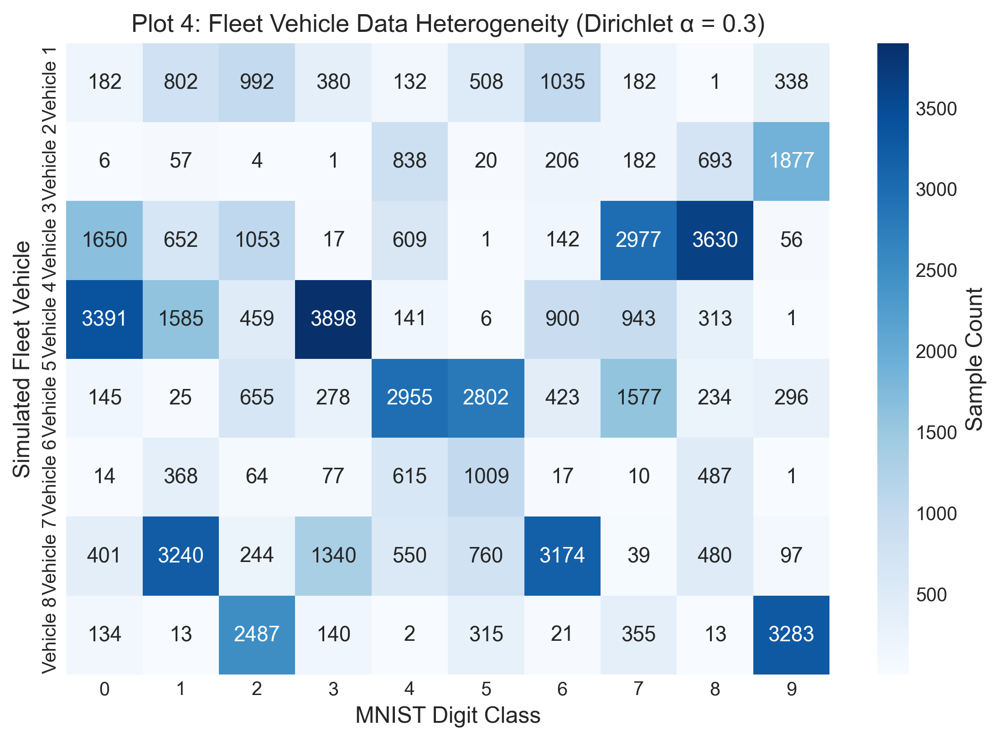
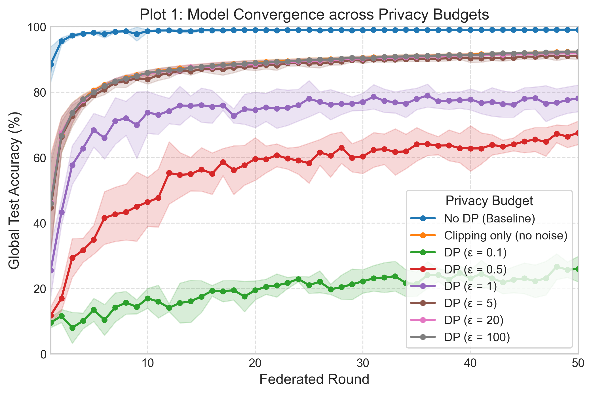
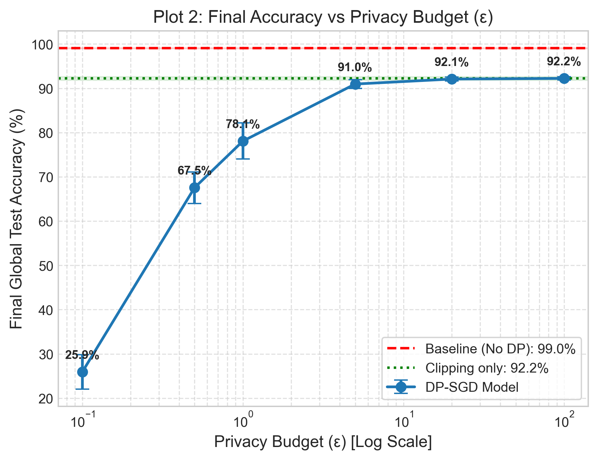
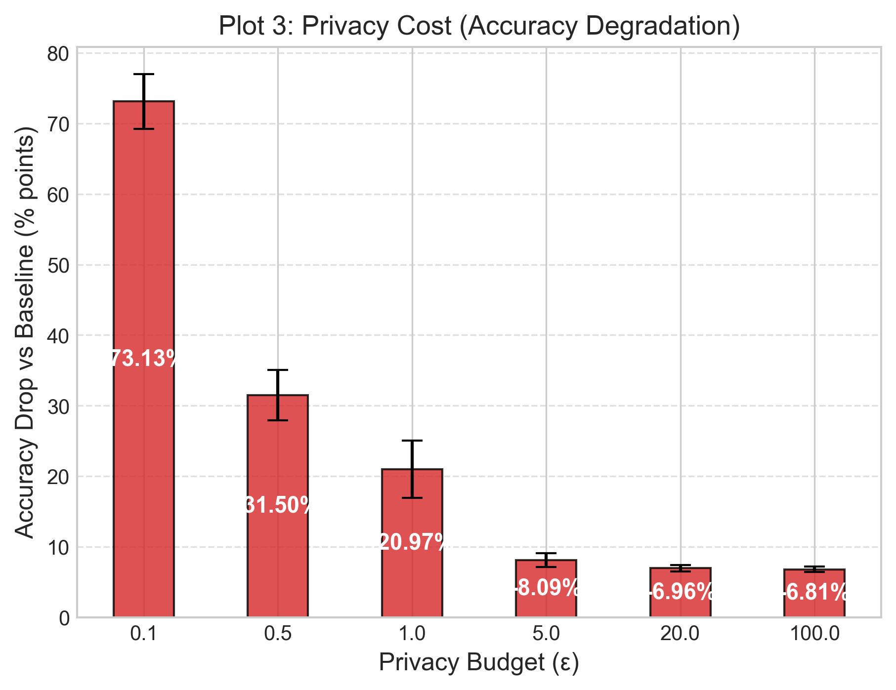

# Experiment Report: Differential Privacy in Federated Fleet Learning

**Generated:** 2026-10-12 11:20:15  
**Artifacts Location:** `../results_robust/`  
**Seeds Evaluated:** [42, 43, 44, 45, 46]

---

## 1. Research Question

> **“Does adding differential privacy to a decentralized/federated optimizer still allow it to train, and what is the accuracy cost?”**

In decentralized settings such as connected vehicular fleets, multiple nodes collaborate to learn a global predictive model without transmitting raw local sensor or perception data. However, gradient updates can leak private information about local training records. This experiment investigates whether injecting client-side differential privacy (via DP-SGD using Opacus) preserves global model convergence under heterogeneous fleet distributions, and measures accuracy across target privacy budgets $\varepsilon \in \{100, 20, 5, 1, 0.5, 0.1\}$. A clipping-only control isolates clipping effects from noise effects.

---

## 2. Experimental Setup

The testbed is constructed using modern open-source federated learning and differential privacy frameworks:

* **Federated Learning Framework:** Flower (`flwr` v1.39.0) using standard Federated Averaging (`FedAvg`).
* **Differential Privacy Engine:** Opacus (`opacus` v1.6.0) utilizing client-side DP-SGD (`PrivacyEngine`).
* **Base Architecture:** Small convolutional network (`MnistCNN`):
  * Conv2D(1 $\to$ 16, kernel=5, pad=2) $\to$ ReLU $\to$ MaxPool(2)
  * Conv2D(16 $\to$ 32, kernel=5, pad=2) $\to$ ReLU $\to$ MaxPool(2)
  * Linear(1568 $\to$ 128) $\to$ ReLU $\to$ Linear(128 $\to$ 10)
* **Dataset & Partitioning:** MNIST benchmark partitioned across **8 simulated fleet vehicles** using a non-IID Dirichlet distribution with concentration parameter $\alpha = 0.3$.
* **Hyperparameters:**
  * Federated rounds: 50
  * Local epochs per round: 3
  * Batch size: 64
  * Learning rate (SGD): 0.05
  * Clipping norm ($C$): 0.5
  * Target delta ($\delta$): $10^{-5}$
* Privacy budgets tested: $\varepsilon \in \{100, 20, 5, 1, 0.5, 0.1\}$, plus a no-DP baseline and a clipping-only, zero-noise control.

---

## 3. Fleet Interpretation & Domain Grounding

In this research prototype, each simulated client corresponds to an autonomous vehicle or connected fleet node holding locally captured sensory or telemetry classifications:
* **Heterogeneous Partitions:** Vehicles operating in different geographical regions or environmental operational domains encounter distinct categorical event frequencies. The non-IID Dirichlet distribution with $\alpha = 0.3$ models this realistic skew (e.g., Vehicle 1 encountering primarily digits 0, 1, and 2, whereas Vehicle 3 observes mostly digits 5 and 6).
* **Controlled Benchmark:** As established in the methodology, **MNIST is strictly used as a controlled benchmark dataset** to guarantee computational tractability and reproducible debugging. It acts as an experimental proxy for uneven local class distributions rather than a substitute for high-dimensional vehicle sensor streams.

---

## 4. Empirical Results

All results presented below are derived from simulated experiment runs executed across random seeds (42, 43, 44, 45, 46).

### 4.1 Final Model Performance vs. Privacy Budget

| Configuration | Epsilon (ε) | Delta (δ) | Noise Multiplier | Final Test Accuracy | Accuracy Cost (Drop) |
| :--- | :---: | :---: | :---: | :---: | :---: |
| **No DP (Baseline)** | N/A | N/A | N/A | 99.04 ± 0.09% | 0.00% |
| **Clipping only (no noise)** | N/A | N/A | 0.0000 | 92.23 ± 0.41% | -6.81% |
| **DP (ε = 100)** | 100.0 | 1e-05 | 0.4907 | 92.23 ± 0.39% | -6.81% |
| **DP (ε = 20)** | 20.0 | 1e-05 | 0.8586 | 92.08 ± 0.45% | -6.96% |
| **DP (ε = 5)** | 5.0 | 1e-05 | 1.9580 | 90.95 ± 0.98% | -8.09% |
| **DP (ε = 1)** | 1.0 | 1e-05 | 7.7734 | 78.07 ± 4.07% | -20.97% |
| **DP (ε = 0.5)** | 0.5 | 1e-05 | 14.6875 | 67.54 ± 3.57% | -31.50% |
| **DP (ε = 0.1)** | 0.1 | 1e-05 | 100.0000 | 25.91 ± 3.89% | -73.13% |

### 4.2 Round-by-Round Convergence Trajectory

| Round | Baseline Acc | Clipping-only Acc | ε=100 Acc | ε=20 Acc | ε=5 Acc | ε=1 Acc | ε=0.5 Acc | ε=0.1 Acc |
| :---: | :---: | :---: | :---: | :---: | :---: | :---: | :---: | :---: |
| 0 | 11.05% | 11.05% | 11.05% | 11.05% | 11.05% | 11.05% | 11.05% | 11.05% |
| 1 | 88.50% | 46.17% | 45.96% | 46.32% | 44.64% | 25.50% | 11.74% | 9.54% |
| 2 | 95.54% | 66.90% | 66.77% | 67.44% | 66.32% | 43.25% | 16.95% | 11.59% |
| 3 | 97.29% | 73.52% | 73.63% | 73.56% | 72.71% | 57.68% | 29.29% | 7.97% |
| 4 | 97.83% | 77.79% | 77.85% | 77.45% | 76.44% | 62.79% | 31.65% | 10.07% |
| 5 | 98.15% | 80.48% | 79.96% | 80.07% | 79.01% | 68.36% | 34.89% | 13.45% |
| 6 | 97.71% | 82.17% | 81.85% | 81.94% | 80.75% | 65.97% | 41.53% | 10.39% |
| 7 | 98.45% | 83.23% | 83.29% | 83.30% | 82.83% | 71.16% | 42.65% | 14.19% |
| 8 | 98.57% | 84.31% | 84.11% | 84.10% | 83.36% | 71.99% | 43.34% | 15.62% |
| 9 | 97.74% | 85.13% | 84.95% | 84.88% | 84.21% | 69.89% | 45.00% | 14.37% |
| 10 | 98.63% | 85.72% | 85.89% | 85.66% | 83.88% | 73.78% | 46.40% | 16.97% |
| 11 | 98.79% | 86.42% | 86.17% | 86.12% | 85.16% | 73.06% | 47.65% | 15.98% |
| 12 | 98.82% | 86.73% | 86.70% | 86.54% | 85.71% | 74.21% | 55.27% | 14.07% |
| 13 | 98.66% | 87.28% | 86.94% | 86.82% | 86.50% | 75.88% | 54.67% | 15.54% |
| 14 | 98.58% | 87.50% | 87.35% | 87.60% | 86.27% | 75.80% | 54.92% | 16.06% |
| 15 | 98.88% | 87.67% | 87.72% | 87.65% | 87.01% | 75.99% | 56.37% | 17.50% |
| 16 | 98.88% | 88.03% | 88.00% | 87.70% | 87.07% | 75.52% | 55.08% | 19.28% |
| 17 | 98.84% | 88.31% | 88.25% | 88.11% | 87.02% | 75.95% | 58.61% | 19.14% |
| 18 | 98.93% | 88.54% | 88.48% | 88.42% | 87.42% | 72.74% | 56.13% | 19.44% |
| 19 | 98.90% | 88.70% | 88.67% | 88.44% | 87.74% | 74.75% | 57.64% | 17.54% |
| 20 | 98.93% | 88.98% | 88.93% | 88.50% | 87.82% | 74.54% | 59.55% | 19.43% |
| 21 | 98.93% | 89.14% | 88.96% | 88.92% | 88.30% | 75.31% | 59.42% | 20.50% |
| 22 | 98.88% | 89.30% | 89.21% | 89.03% | 88.16% | 74.97% | 60.67% | 20.90% |
| 23 | 98.97% | 89.43% | 89.31% | 89.14% | 88.84% | 75.20% | 59.68% | 21.67% |
| 24 | 98.95% | 89.60% | 89.58% | 89.36% | 88.87% | 75.98% | 59.08% | 22.87% |
| 25 | 98.99% | 89.80% | 89.74% | 89.60% | 88.71% | 77.95% | 58.27% | 21.00% |
| 26 | 98.83% | 89.90% | 89.92% | 89.59% | 88.78% | 76.99% | 61.56% | 22.03% |
| 27 | 98.98% | 90.06% | 89.93% | 89.79% | 89.07% | 76.15% | 60.59% | 19.74% |
| 28 | 98.93% | 90.10% | 90.23% | 90.02% | 89.30% | 76.43% | 63.00% | 20.37% |
| 29 | 98.88% | 90.29% | 90.42% | 90.20% | 89.78% | 76.40% | 59.92% | 21.25% |
| 30 | 98.97% | 90.41% | 90.39% | 90.23% | 89.55% | 76.98% | 60.33% | 22.16% |
| 31 | 98.99% | 90.59% | 90.50% | 90.38% | 89.90% | 78.55% | 62.32% | 23.08% |
| 32 | 98.96% | 90.68% | 90.69% | 90.53% | 89.90% | 77.34% | 62.54% | 23.33% |
| 33 | 98.97% | 90.77% | 90.80% | 90.50% | 89.90% | 76.84% | 61.70% | 23.73% |
| 34 | 99.01% | 90.87% | 90.87% | 90.63% | 90.02% | 76.44% | 61.85% | 21.61% |
| 35 | 98.97% | 90.99% | 90.94% | 90.84% | 90.00% | 77.91% | 64.03% | 21.33% |
| 36 | 98.97% | 91.08% | 91.05% | 90.89% | 90.00% | 78.92% | 64.09% | 24.13% |
| 37 | 98.98% | 91.16% | 91.16% | 90.90% | 90.16% | 77.18% | 63.63% | 24.10% |
| 38 | 99.04% | 91.32% | 91.30% | 91.17% | 90.36% | 77.36% | 63.73% | 22.63% |
| 39 | 98.99% | 91.35% | 91.36% | 91.15% | 90.47% | 77.55% | 62.87% | 24.70% |
| 40 | 98.98% | 91.48% | 91.38% | 91.38% | 90.28% | 77.75% | 62.76% | 23.14% |
| 41 | 99.04% | 91.55% | 91.44% | 91.31% | 90.27% | 76.67% | 62.77% | 24.42% |
| 42 | 99.05% | 91.62% | 91.69% | 91.49% | 90.40% | 76.98% | 63.87% | 23.11% |
| 43 | 99.04% | 91.72% | 91.80% | 91.45% | 90.49% | 76.34% | 63.33% | 21.85% |
| 44 | 99.05% | 91.76% | 91.80% | 91.64% | 90.43% | 76.13% | 64.01% | 22.66% |
| 45 | 98.95% | 91.91% | 91.91% | 91.72% | 90.86% | 77.96% | 64.89% | 23.08% |
| 46 | 99.06% | 92.00% | 91.94% | 91.73% | 90.77% | 78.17% | 65.50% | 22.19% |
| 47 | 99.05% | 92.05% | 92.09% | 91.82% | 91.05% | 76.46% | 64.79% | 23.12% |
| 48 | 99.05% | 92.19% | 92.11% | 91.88% | 90.92% | 76.73% | 67.25% | 26.63% |
| 49 | 99.06% | 92.24% | 92.15% | 91.96% | 91.01% | 77.54% | 66.41% | 25.73% |
| 50 | 99.04% | 92.23% | 92.23% | 92.08% | 90.95% | 78.07% | 67.54% | 25.91% |

### 4.3 Visualizations

| Convergence Trajectory | Accuracy vs. Privacy Budget |
| :---: | :---: |
|  |  |

| Accuracy Degradation (Privacy Penalty) | Fleet Data Heterogeneity |
| :---: | :---: |
|  |  |

---

## 5. Scientific Interpretation

1. **Convergence Feasibility:**
    The table and trajectories above summarize observed convergence for each tested privacy budget $\varepsilon \in \{100, 20, 5, 1, 0.5, 0.1\}$. Conclusions about stability should be drawn from these measured runs rather than assumed from the target epsilon alone.

2. **Privacy vs. Utility Trade-off:**
    Compare the measured mean and standard deviation across the no-DP baseline, clipping-only control, and each DP budget above. The clipping-only gap estimates the effect of clipping; the additional gap between clipping-only and DP-SGD includes noise and privacy-accounting effects.

3. **Fleet Heterogeneity Interactions:**
   Under Dirichlet $\alpha = 0.3$, clients compute updates from non-uniform distributions. When combined with per-sample clipping, minority class gradients on specific vehicles risk disproportionate attenuation before noise addition. Despite this challenge, FedAvg effectively aggregated updates to construct a balanced global model.

---

## 6. Limitations

To maintain scientific honesty, the following constraints of this research prototype must be recognized:
* **Proxy Dataset:** MNIST features low spatial complexity and 10 balanced global classes; real vehicular telemetry consists of multi-modal, asynchronous time-series signals and LiDAR/camera perception streams.
* **Privacy Scope:** DP is applied as **client-side local DP-SGD** (record-level privacy on local updates). This limits information leakage regarding individual local training instances, but does not provide client-level differential privacy (protecting the identity/participation of an entire vehicle).
* **Cryptographic Guarantees:** Model parameter exchanges do not employ Secure Multiparty Computation (SMPC) or Homomorphic Encryption (HE); server-side eavesdropping or untrusted aggregation is not defended against.
* **Adversarial Robustness:** The system assumes honest-but-curious clients and does not defend against Byzantine attacks, model poisoning, or backdoors.
* **Scale & Communication:** Experiments simulate 8 nodes over 50 rounds on CPU; real fleet deployments require handling tens of thousands of intermittent nodes with lossy communications.

---

## 7. Future Work

* **Complex Vision & Telemetry:** Benchmarking on CIFAR-10, German Traffic Sign Recognition (GTSRB), and real automotive CAN bus time-series.
* **Combined Cryptographic Protections:** Integrating client-level differential privacy with Secure Aggregation protocols.
* **Adaptive Clipping & Optimizers:** Exploring adaptive clipping mechanisms and decentralized second-order optimizers (e.g., AD-KFAC) with DP guarantees.
* **Communication Compression:** Combining gradient quantization/sparsification with differential privacy to minimize bandwidth consumption in mobile cellular vehicle networks.
